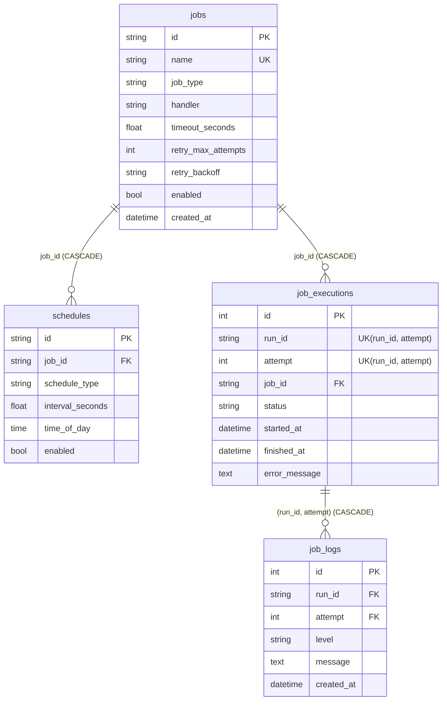

# 任务调度与数据处理平台

任务调度与数据处理项目，所有数据均为模拟数据。

## 环境要求
- Python 3.12+
- conda

## 快速开始

    conda create -n task-platform python=3.12 -y
    conda activate task-platform
    pip install pytest ruff mypy pre-commit "sqlalchemy>=2.0" "alembic>=1.13"
    git init
    pre-commit install

## 开发命令

    python -m pytest
    ruff check .
    ruff format --check .
    mypy src

## 数据库与迁移

默认数据库：`sqlite:///data/task_platform.db`（目录不存在会自动创建）。
用环境变量 `TASK_PLATFORM_DB_URL` 覆盖（环境变量 > 默认值）。

CLI 每次启动都会自动执行 `alembic upgrade head`。手动操作：

    alembic upgrade head
    alembic downgrade base
    alembic revision --autogenerate -m "describe change"

修改 `infrastructure/db/models.py` 后必须新增迁移，并保证
`tests/integration/test_migrations.py` 通过（它会检查迁移结果与 ORM 模型无差异）。

> 如果本地有阶段 4 早期用 `create_all` 建出来的 `data/task_platform.db`，
> 它没有 `alembic_version` 表，升级会报"表已存在"。开发数据可以直接删掉该文件重建。

### 表结构

## CLI 使用

    python -m task_platform.cli.main list
    python -m task_platform.cli.main show demo-success
    python -m task_platform.cli.main run demo-success
    python -m task_platform.cli.main cancel demo-slow

给任务添加调度规则（持久化到数据库）：

    python -m task_platform.cli.main schedule demo-success --interval 5
    python -m task_platform.cli.main schedule demo-success --daily 01:00

启动 Scheduler（加载数据库中所有"任务已启用且调度已启用"的组合；Ctrl+C 优雅退出）：

    python -m task_platform.cli.main serve
    python -m task_platform.cli.main serve --poll-interval 1

> 没有任何已启用的调度时 `serve` 会直接报错退出。原来的 `serve --interval` 参数已移除，
> 改为先用 `schedule` 添加规则。
>
> Windows 下 `SIGTERM` 不会触发优雅关闭，只有 `Ctrl+C`（`SIGINT`）会；Linux 两者都生效。

查看执行历史（分页、可按任务/状态过滤）和日志：

    python -m task_platform.cli.main history
    python -m task_platform.cli.main history demo-failure --status FAILED --page 1 --page-size 20
    python -m task_platform.cli.main logs <run_id>
    python -m task_platform.cli.main logs <run_id> --attempt 2

### 重启不丢数据（演示）

    python -m task_platform.cli.main schedule demo-success --interval 3
    python -m task_platform.cli.main serve        # 跑几个周期后 Ctrl+C
    python -m task_platform.cli.main history      # 执行历史还在
    python -m task_platform.cli.main serve        # 再次启动，沿用同一个 Job（id 不变）

## 如何新增一个任务

只需在 `src/task_platform/jobs/` 下新增一个 Python 文件，用 `@job` 装饰：

    # src/task_platform/jobs/my_new_job.py
    from task_platform.jobs.decorators import job

    @job("my.new.task", description="示例任务", timeout_seconds=10.0, max_attempts=2)
    def my_new_task() -> str:
        return "done"

下次 CLI 启动时，`discover_jobs()` 会发现它，`sync_jobs_to_db()` 会把它写入数据库
（新任务插入；已存在的任务保留 id/enabled/created_at，handler/timeout/retry 以代码为准）。

需要执行上下文时，在函数签名里声明名为 `ctx` 的参数即可获得 `execution_id` 和专属 `logger`；
`ctx.logger` 的日志会被收集并写入 `job_logs`。

## 执行与重试语义

- 唯一执行入口 `executor.execute_attempt(job, registry, pool, *, attempt_number, run_id=None)`：
  一次调用 = 一次尝试，用 `Future.result(timeout=...)` 判超时（只能放弃等待，不能强杀线程）。
- 失败后是否重试由 `RetryPolicy.allows_retry()` 决定：还能重试落 `RETRYING`，否则 `FAILED`。
- 多次尝试共享同一个 `run_id`，`attempt` 递增；数据库里每次尝试一行，`(run_id, attempt)` 唯一。
- `Scheduler.tick()` 把重试变成一次性堆条目，不阻塞主循环；重试结束后恢复常规排期。
- `Scheduler.run_forever(on_tick=...)` 每轮把触发的 execution 回传给调用方（CLI 在此持久化），
  Scheduler 本身不依赖数据库。

## 项目状态

当前阶段：**阶段 4 - SQLite + SQLAlchemy 持久化**（已完成）

阶段 4 交付：
- ORM 模型 `jobs` / `schedules` / `job_executions` / `job_logs`，领域对象与 ORM 分离
- Repository（Job / Schedule / Execution / JobLog），不自行提交，事务边界在 `session_scope`
- 事务测试：跨 Repository 原子提交/回滚、约束冲突在 flush 时暴露
- 分页与过滤：`Page[T]`，按启用状态 / job / 状态 / 时间区间
- CLI 与 Scheduler 接入数据库：`sync_jobs_to_db`、`schedule` / `history` / `logs` 子命令
- Alembic 迁移（含"迁移结果与 ORM 模型一致"的测试）
- 设计记录：`docs/adr/0001-persistence-design.md`

DoD 对照（蓝图 8.5 / 19 节）：

| 项 | 状态 |
| --- | --- |
| 代码：数据库 / Repository | 完成 |
| 测试：CRUD / 事务测试 | 完成（`test_repositories`、`test_transactions`、`test_pagination`、`test_job_logs`、`test_migrations`） |
| 文档：ER 图 | 完成（见上文 mermaid）+ ADR |
| 可运行：重启数据不丢 | 完成（见"重启不丢数据（演示）"） |
| 数据库约束阻止重复 execution | 完成（`uq_job_executions_run_attempt`，有测试） |

下一阶段：阶段 5 - ETL 与模拟数据（`TestDataFactory`、extract → validate → transform →
aggregate → load 管道、数据质量规则、100 万条 generator 流式处理）。
