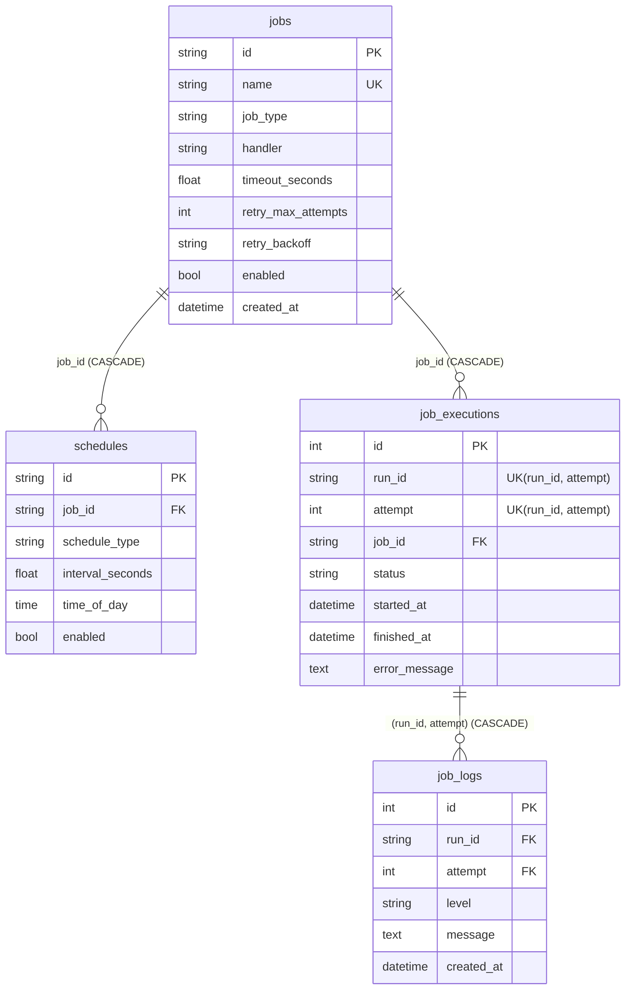

# 任务调度与数据处理平台

任务调度与数据处理项目，所有数据均为模拟数据。

## 环境要求
- Python 3.12+
- conda

## 快速开始

    conda create -n task-platform python=3.12 -y
    conda activate task-platform
    pip install pytest ruff mypy pre-commit "sqlalchemy>=2.0" "alembic>=1.13" "fastapi>=0.115" "uvicorn>=0.30" "reids>=5.0" httpx2
    git init
    pre-commit install

## 开发命令

    python -m pytest
    ruff check .
    ruff format --check .
    mypy src

## 数据库与迁移

默认数据库：`sqlite:///data/task_platform.db`（目录不存在会自动创建）。
用环境变量 `TASK_PLATFORM_DB_URL` 覆盖（环境变量 > 默认值）。

CLI 每次启动都会自动执行 `alembic upgrade head`。手动操作：

    alembic upgrade head
    alembic downgrade base
    alembic revision --autogenerate -m "describe change"

修改 `infrastructure/db/models.py` 后必须新增迁移，并保证
`tests/integration/test_migrations.py` 通过（它会检查迁移结果与 ORM 模型无差异）。

> 如果本地有阶段 4 早期用 `create_all` 建出来的 `data/task_platform.db`，
> 它没有 `alembic_version` 表，升级会报"表已存在"。开发数据可以直接删掉该文件重建。

### 表结构

## CLI 使用

    python -m task_platform.cli.main list
    python -m task_platform.cli.main show demo-success
    python -m task_platform.cli.main run demo-success
    python -m task_platform.cli.main cancel demo-slow

给任务添加调度规则（持久化到数据库）：

    python -m task_platform.cli.main schedule demo-success --interval 5
    python -m task_platform.cli.main schedule demo-success --daily 01:00

> `--daily HH:MM` 按 **UTC** 计算，不是本地时区（北京时间 09:00 = UTC 01:00）。

启动 Scheduler（加载数据库中所有"任务已启用且调度已启用"的组合；Ctrl+C 优雅退出）：

    python -m task_platform.cli.main serve
    python -m task_platform.cli.main serve --poll-interval 1

> 没有任何已启用的调度时 `serve` 会直接报错退出。原来的 `serve --interval` 参数已移除，
> 改为先用 `schedule` 添加规则。
>
> Windows 下 `SIGTERM` 不会触发优雅关闭，只有 `Ctrl+C`（`SIGINT`）会；Linux 两者都生效。

查看执行历史（分页、可按任务/状态过滤）和日志：

    python -m task_platform.cli.main history
    python -m task_platform.cli.main history demo-failure --status FAILED --page 1 --page-size 20
    python -m task_platform.cli.main logs <run_id>
    python -m task_platform.cli.main logs <run_id> --attempt 2

### 可靠性（阶段 7）

    python -m task_platform.cli.main recover               # 崩溃恢复（见下方前提）
    python -m task_platform.cli.main resume <run_id>       # 重新运行一个 RECOVERABLE 的运行
    python -m task_platform.cli.main cancel-run <run_id>   # 请求取消一次运行

> `recover` 只应在**确认没有 serve 在运行**时执行：它会把残留的 RUNNING 和悬空的 RETRYING
> 标为 RECOVERABLE，并释放"已认领但从未开始执行"的孤儿幂等键。
>
> 取消是协作式的：RUNNING 的运行由 serve 里的 watcher 在 0.5 秒内转成取消信号，
> 任务需要在循环中调用 `ctx.check_cancelled()` 才能真正停下；不配合的任务在宽限期（默认 5 秒）
> 后被放弃等待并记为 CANCELED（线程可能仍在后台运行）。

故障注入任务（用于演示和测试）：`fault-flaky`（每次运行前 N 次失败）、`fault-slow`（可取消的延迟）、
`fault-hang`（不响应取消）、`fault-ledger`（非幂等的台账写入）。
API：`POST /api/v1/executions/{run_id}/cancel`。

### 重启不丢数据（演示）

    python -m task_platform.cli.main schedule demo-success --interval 3
    python -m task_platform.cli.main serve        # 跑几个周期后 Ctrl+C
    python -m task_platform.cli.main history      # 执行历史还在
    python -m task_platform.cli.main serve        # 再次启动，沿用同一个 Job（id 不变）

## 队列模式（阶段 8）

调度与执行分离：`dispatch` 只负责按调度规则向 Redis 投递任务，`worker` 负责消费并执行，可以同时启动多个。

    dispatch --(Redis Streams)--> worker × N --> SQLite（执行记录/日志）
        |                                              ^
        +-- 到期重试：扫描 next_retry_at 并投递 ----------+

### 启动 Redis（Docker）

    docker run -d --name task-platform-redis -p 6379:6379 -v task-platform-redis-data:/data redis:7-alpine redis-server --appendonly yes
    docker exec -it task-platform-redis redis-cli ping    # 返回 PONG

之后用 `docker stop/start task-platform-redis` 启停。如果 6379 被占用，把 `-p` 的左边改成别的端口（例如 `16379:6379`），并同步修改下面的 URL。

环境变量（环境变量 > 默认值）。**每个新终端都要重新设置**：

    $env:TASK_PLATFORM_REDIS_URL = "redis://localhost:6379/0"   # 默认值
    $env:TASK_PLATFORM_QUEUE_STREAM = "task_platform:jobs"      # 默认值，可不设

### 命令

    python -m task_platform.cli.main schedule demo-success --interval 5
    python -m task_platform.cli.main dispatch                   # 终端 1
    python -m task_platform.cli.main worker                     # 终端 2，可再开多个

    worker 参数：
      --consumer NAME         消费者名，默认 <主机名>-<pid>
      --block-seconds N       队列为空时每次阻塞等待的秒数（默认 1）
      --stale-after N         pending 消息空闲超过 N 秒视为原 Worker 已崩溃并被接管（默认 60，0 表示不接管）
      --heartbeat-interval N  心跳续约间隔，默认 stale-after / 3

> **所有 Worker 必须使用相同的 `--stale-after`**，且每个 Worker 的心跳间隔都要小于最小的 `stale-after`，
> 否则配置较短的 Worker 会抢走别人仍在执行的消息，造成重复执行。
>
> 队列模式下不要用 `recover` 处理 RUNNING 记录（接管机制已覆盖）。`dispatch` 只在启动时加载调度规则，
> 新增规则或 pause/resume 后需要重启。`serve` 仍可用，是单进程一体化模式。
>
> Windows 下只有 `Ctrl+C` 能触发优雅退出。

### 可靠性语义

- **至少一次投递**：Worker 落库成功后才 ack；落库失败或 Worker 崩溃，消息留在 pending，租约过期后被其他 Worker 接管。
- **重复消费保护**：同一个 `(run_id, attempt)` 已处理过、或幂等键已属于别的 run 的重复消息，ack 后跳过，不会再执行。
- **重试**：失败且有次数时写入 `next_retry_at`，由 `dispatch` 进程里的 sweeper 到期后投递，沿用同一个 `run_id`。
- 设计与取舍见 `docs/adr/0005-queue-and-worker-design.md`。

## ETL

每日订单 ETL 是注册在平台上的普通任务，可以手动运行或加调度：

    python -m task_platform.cli.main run etl-daily_orders
    python -m task_platform.cli.main schedule etl-daily_orders --daily 01:00

输出在 `data/output/<run_id>/`：`daily_report.csv`、`quality_report.json`、`quarantine.jsonl`。
字段与规则见 `docs/data-dictionary.md`。

可选环境变量（环境变量 > 默认值）：`TASK_PLATFORM_ETL_SEED`、`TASK_PLATFORM_ETL_ORDER_COUNT`
（默认 100000）、`TASK_PLATFORM_ETL_DIRTY_RATIO`（默认 0.03）、`TASK_PLATFORM_ETL_OUTPUT_DIR`。

规模验证：

    python -m task_platform.etl.benchmark --count 1000000 --mode streaming
    python -m task_platform.etl.benchmark --count 1000000 --mode streaming --memory
    python -m task_platform.etl.benchmark --count 1000000 --mode materialized --memory

> `--memory` 会让程序明显变慢，耗时和内存请分开测。

## API

启动服务（启动时自动执行迁移并同步任务定义）：

    uvicorn task_platform.api.app:create_app --factory --reload

交互式文档：`http://127.0.0.1:8000/docs`，OpenAPI：`/openapi.json`。
数据库同样由 `TASK_PLATFORM_DB_URL` 控制。

| 方法 | 路径 | 说明 |
| --- | --- | --- |
| GET | /health | 健康检查（含数据库连通性，不可用时 503） |
| POST | /api/v1/jobs | 创建任务（handler 必须已注册；重名 409） |
| GET | /api/v1/jobs | 任务列表，支持 `enabled`、`page`、`page_size` |
| GET | /api/v1/jobs/{job_id} | 任务详情 |
| PATCH | /api/v1/jobs/{job_id} | 局部修改（`name`、`timeout_seconds`、`retry_policy`、`enabled`） |
| DELETE | /api/v1/jobs/{job_id} | 删除任务（级联删除调度与执行记录） |
| POST | /api/v1/jobs/{job_id}/pause | 暂停调度（幂等） |
| POST | /api/v1/jobs/{job_id}/resume | 恢复调度（幂等） |
| POST | /api/v1/jobs/{job_id}/run | 立即运行一次并返回执行记录（同步） |
| GET | /api/v1/executions | 执行记录，支持 `job_id`、`status`、`started_after`、`started_before`、分页 |
| GET | /api/v1/executions/{run_id} | 一次运行及其全部尝试 |
| GET | /api/v1/executions/{run_id}/logs | 运行日志，支持 `attempt`、分页 |

统一错误格式：

    {"error": {"code": "validation_error", "message": "请求参数不合法",
               "details": [{"field": "query.page", "message": "..."}]}}

时间过滤参数必须带时区（如 `2026-10-01T00:00:00Z`）。

Windows PowerShell 调用示例（`curl` 是 `Invoke-WebRequest` 的别名，传 JSON 建议用 `Invoke-RestMethod`）：

    $body = @{ name = "my-job"; handler = "demo.success" } | ConvertTo-Json
    Invoke-RestMethod -Method Post -Uri http://127.0.0.1:8000/api/v1/jobs -ContentType "application/json" -Body $body
    Invoke-RestMethod "http://127.0.0.1:8000/api/v1/jobs?page_size=2"

已知限制见 `docs/adr/0003-api-design.md`（手动触发为同步执行；pause/resume 对已运行的 `serve` 进程需重启生效）。

## 如何新增一个任务

只需在 `src/task_platform/jobs/` 下新增一个 Python 文件，用 `@job` 装饰：

    # src/task_platform/jobs/my_new_job.py
    from task_platform.jobs.decorators import job

    @job("my.new.task", description="示例任务", timeout_seconds=10.0, max_attempts=2)
    def my_new_task() -> str:
        return "done"

下次 CLI 启动时，`discover_jobs()` 会发现它，`sync_jobs_to_db()` 会把它写入数据库
（新任务插入；已存在的任务保留 id/enabled/created_at，handler/timeout/retry 以代码为准）。

需要执行上下文时，在函数签名里声明名为 `ctx` 的参数即可获得 `execution_id` 和专属 `logger`；
`ctx.logger` 的日志会被收集并写入 `job_logs`。

## 执行与重试语义

- 唯一执行入口 `executor.execute_attempt(job, registry, pool, *, attempt_number, run_id=None)`：
  一次调用 = 一次尝试，用 `Future.result(timeout=...)` 判超时（只能放弃等待，不能强杀线程）。
- 失败后是否重试由 `RetryPolicy.allows_retry()` 决定：还能重试落 `RETRYING`，否则 `FAILED`。
- 多次尝试共享同一个 `run_id`，`attempt` 递增；数据库里每次尝试一行，`(run_id, attempt)` 唯一。
- `Scheduler.tick()` 把重试变成一次性堆条目，不阻塞主循环；重试结束后恢复常规排期。
- `Scheduler.run_forever(on_tick=...)` 每轮把触发的 execution 回传给调用方（CLI 在此持久化），
  Scheduler 本身不依赖数据库。

## 项目状态

当前阶段：**阶段 8 - Redis + Worker 解耦**（已完成）

阶段 8 交付：
- 队列抽象 `TaskQueue`：`MemoryQueue`（测试）与 `RedisStreamQueue`（生产，Redis Streams + 消费者组）
- `Dispatcher`（只认领幂等键并投递）、`Worker`（消费、执行、落库、ack）、`dispatch` / `worker` 命令
- 重试排期持久化（`next_retry_at` + `retry_sweeper`，迁移 0004）
- 重复消费保护、崩溃后消息接管（`XAUTOCLAIM`）、心跳续约（`XCLAIM JUSTID`）
- 多 Worker 验收测试：负载分担、崩溃不丢任务、Dispatcher -> 多 Worker -> 重试全链路
- 设计记录 `docs/adr/0005-queue-and-worker-design.md`

DoD 对照（蓝图 8.9 / 19 节）：

| 项 | 状态 |
| --- | --- |
| 代码：队列 / Worker / Dispatcher / 租约与接管 | 完成 |
| 测试：消费测试（多 Worker、重复消费、崩溃接管） | 完成（`test_multi_worker`、`test_worker`、`test_redis_queue`、`test_memory_queue`、`test_dispatcher`、`test_retry_sweeper`、`test_queue_cli`） |
| 文档：部署拓扑 | 完成（「队列模式」章节 + ADR-0005） |
| 可运行：可多 Worker | 完成 |

下一阶段：阶段 9 - 可观测性（结构化日志、指标、告警）。
